# SysMon

A compact system monitor for AMD-GPU Linux desktops — and a system
state API you can script against. One Rust binary: the window, the
engine, the CLI, the socket.

Every number it shows is checked against the tool a skeptic would open
beside it (`free`, `turbostat`, `mpstat`, `sensors`, `iostat`, `pidstat`,
`df`, firmware tables) on real hardware, idle, under load and under a
known disk writer: **66 of 66 agree.**

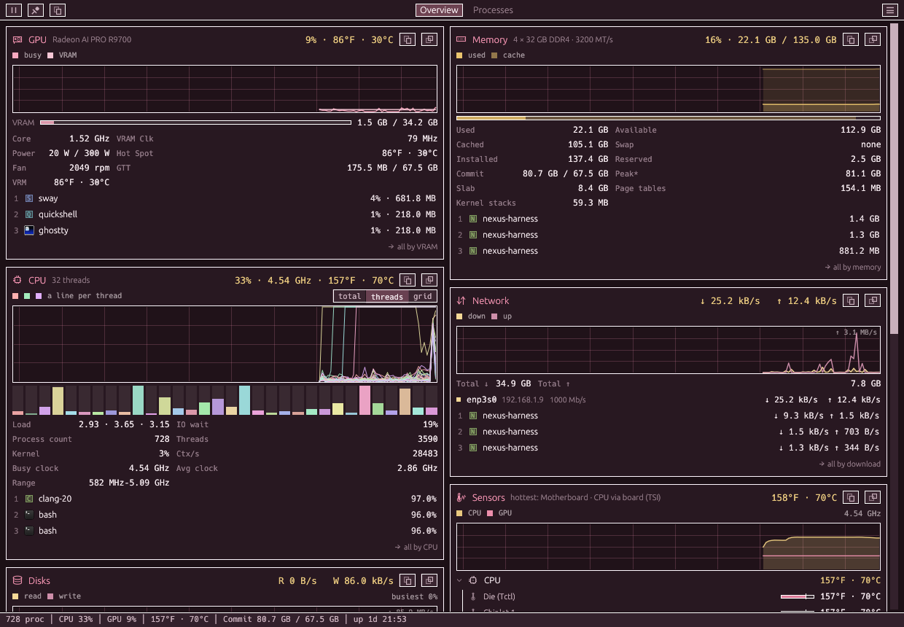

Every number the window shows is one command away:

```bash
sysmon probe network --json | jq .result.network.top_processes
```

## v1 → v3, honestly

v2 was a ground-up rewrite and v3 is that engine grown up. The
Python/GTK3 tree (tag `v1.0.0`) is gone; same information priority,
new engine.

| | v1 (Python/GTK3) | v3 (Rust/egui) |
|---|---|---|
| engine | psutil + nethogs | own /proc·/sys collectors, netlink sock_diag, optional nethogs merge |
| per-process network | nethogs only (or nothing) | native TCP attribution with zero setup; nethogs upgrades it to UDP/QUIC + all users |
| programmatic access | none | `probe` / `tap` / `ctl` / `schema` + control socket, JSON envelopes, a strict machine contract, and a conformance harness that re-runs the whole standard |
| idle CPU (same display, 60 s, software rendering) | 13.0% of a core | **6.0%** — and `serve` idles at **0.00% / 5.6 MB** |
| accuracy | trusted psutil | a 66-check live audit against free/turbostat/mpstat/sensors/iostat/pidstat/df/DMI, plus cross-checks in `cargo test` |
| theming | adopts the GTK theme | eleven built-in palettes (including a greyscale a11y floor) + a System mode that maps your GTK theme to the nearest family, and honors high-contrast and reduced-motion |
| process icons | icon theme lookup, gaps common | desktop-entry index over the real icon-theme inherit chain, letter-tile fallback |

**Not carried over / changed, said out loud:**
- v1 literally *wore* your GTK theme; v3 draws its own chrome. System
  mode reads your Cinnamon/GNOME theme name and picks the closest
  family (Blossom → Blossom Dark, `*-Dark*` → Dark, else Light).
- Funky Pink kept its colors and lost its wonky corners — everything
  is sharp-cornered now, by design.
- Drag-a-pop-out-back-to-dock needs X11 (button state); on Wayland
  use the ⧉ toggle or close the pop-out. Everything else is
  display-server-agnostic.
- NVIDIA: since 3.7 an NVIDIA card gets its own card under the GPU card
  (read through NVML; a compute-only card beside an AMD one is the case
  it was built for). Intel GPUs: still an honest "no AMD GPU" card.
- v3 changed the wire in one way worth knowing: `ts` is now ISO-8601
  with a UTC offset rather than a float (the epoch rides along as
  `ts_epoch`), error envelopes carry an `exit` code, and every NDJSON
  stream line carries `event`. Everything v2 emitted, v3 still emits.

Your v1 `settings.json` is read and migrated in place — including the
detail that v1's "Blossom" *was* the AMOLED look, so that's what it
becomes.

## What it shows

### Overview (the front page)

Six cards, one per resource, each with its graph on a dark instrument
field and the numbers under it. One column in a narrow window, two
side by side from 880 px. A status bar along the bottom keeps the
headline numbers in view while the cards scroll (`636 proc │ CPU 4% │
GPU 3% │ 160°F · 71°C │ Commit 30.1 GB / 67.5 GB │ up 3d 04:12`).

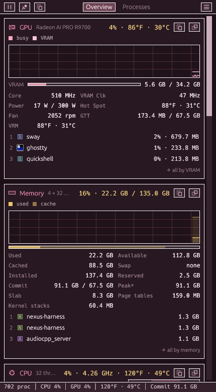

| Card | Graph | Readings |
|---|---|---|
| **GPU** | busy, with VRAM as a second trace | busy %, VRAM bar, core/VRAM clocks (averaged across the window, not one lucky read), power vs cap, edge + hot-spot + **VRM** temps, fan, **GTT**, top-3 GPU processes — amdgpu sysfs, `gpu_metrics` + DRM fdinfo |
| **Memory** | used, with cache stacked above it | used / available / cached as a share bar, swap, and the three totals told apart: **installed** (your sticks, from firmware), **usable** (what the kernel gets), **reserved** (the difference); **commit charge** against its limit and SysMon's own peak since launch (labelled `Peak*`); **kernel memory** (slab, page tables, stacks). The subtitle names the sticks and the speed they actually run at. Top-3 by RSS |
| **CPU** | three views, below | overall + per-thread bars, the **busy clock** (what the working cores actually delivered, the number turbostat calls Bzy_MHz), package temp, load, **IO wait** (kept out of busy %), **kernel time**, the kernel's thread count, ctx/s, top-3 by CPU |
| **Network** | down and up, autoscaled with the ceiling written in the corner | live ↓/↑ (physical interfaces), totals, **per-interface rows with IPs and link speed**, top-3 by traffic with **↓/↑ split**, source disclosure |
| **Disks** | read and write across drives, the busiest drive's util beside the legend | every real mounted drive: label, R/W rates, **util %**, usage bar |
| **Sensors** | CPU and GPU temperature over time, the busy clock beside it | grouped by what they measure: CPU, each drive by model, motherboard. Plain names (*Die (Tctl)*, *Chiplet 1*, *Fan header 2*), a heat bar against each sensor's own limit, fans with drive % beside rpm (a fan driven at 50% that reads 0 rpm stands out), unconnected inputs folded away, battery when present. No warnings: the heat is shown next to the clock it costs, and the data speaks |

**The CPU card has three views**, on a carved switch beside its
legend. **threads** (the default) draws every thread as its own
coloured line on one field; point at a line, or at a thread's bar
underneath, and that thread comes forward while the rest dim. **total**
is one trace, busy with kernel time beneath it. **grid** is a small
graph per thread. `sysmon ctl cpugraph threads|total|grid` sets it from
a script.

Kernel time, commit charge and kernel memory are audited like
everything else: C7 against `mpstat`, M7/M8 against `/proc/meminfo`.

Temperatures read in **°F, °C, or both at once** ("131°F · 55°C"), and
sizes in decimal GB by default (binary is one click away). Both live in
the ☰ menu.

Any card pops out into its own always-pinned window (⧉) — it keeps
updating with the main window minimized, and **dropping it onto the
main window docks it back**. Pop-outs are remembered across launches.
Every SysMon window carries the app_id `sysmon`, so one compositor rule
can float them all (Sway: `for_window [app_id="^sysmon$"] floating
enable`).

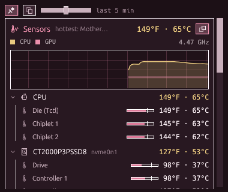

The **copy button** (two sheets, top-left) puts a spec sheet on the
clipboard, ready for a forum post or a bug report. It describes what
the machine *is*:

```
OS        Linux Mint 22.3 (Ubuntu 24.04 base)
Desktop   SwayFX 0.6-c4c8d51b (Sway 1.12.0) · Wayland
CPU       AMD Ryzen 9 5950X 16-Core Processor
          16 cores / 32 threads · 3.40 GHz base · up to 5.09 GHz
          L2 8 MiB · L3 64 MiB
Memory    4 × 32 GB DDR4-3200 · Corsair CMK128GX4M4E3200C16 · dual-rank
          installed 137.4 GB (128.0 GiB) · 4 of 4 slots used
GPU       AMD Radeon AI PRO R9700 · 34.2 GB (31.9 GiB) VRAM
          RDNA 4 (gfx1201) · 64 CUs · PCIe 4.0 x16 (card supports 5.0) · 300 W cap (max 330 W)
          Vulkan 1.4.318 · Mesa 25.2.8-0ubuntu0.24.04.2 (RADV)
Storage   CT2000P3PSSD8 · NVMe SSD · 2.0 TB · PCIe 4.0 x4
            vfat (EFI) · btrfs (system, home, data)
…
```

That covers the OS and its base, the desktop, board and firmware, the
CPU's topology, clocks, caches and instruction sets, every memory
stick, each GPU with the PCIe link it actually gets and its driver
stack, displays at their running mode, every physical drive (mounted
or not), network and audio. The sheet carries no hostname, serials,
addresses or mount paths: a drive says what it holds, not where it's
mounted. `sysmon specs` prints the same sheet in a terminal.

### Usage history, and a copy button per section

SysMon keeps a **usage history** on disk while it runs: CPU, memory,
GPU (and every program holding it), network, disks, temperatures and
fans, one line per sample. Each card has its own copy button (in a
pop-out it sits beside the pin, with a slider for how far back to
copy, from 5 minutes up to the oldest record on disk). It copies that
section's specs and then its usage over that range:

```
Usage · last 10 min · 2026-10-10 17:55–18:05 PDT
289 samples, one every 2 s, covering 10 min of it

                    min       avg       p95       max
GPU busy           1.0%      7.2%       14%       34%
VRAM used       26.4 GB   26.5 GB   26.6 GB   26.6 GB
Power              22 W      41 W      48 W      60 W
Junction temp      35°C      37°C      38°C      39°C
…
Timeline, one block per 13 s (% and memory: ▁ empty … █ full; the rest: ▁ its min … █ its max; blank = not recorded)
VRAM used       ▇▇▇▇▇▇▇▇▇▇▇▇▇▇▇▇▇▇▇▇▇▇▇▇▇▇▇▇▇▇▇▇▇▇▇▇▇▇▇▇▇▇▇▇▇▇▇
Junction temp   ▁▁▂▁▁▁▂▂▂▃▃▄▃▄▄▄▄▄▄▄▄▄▄▄▄▄▄▄▄▄▄▄▅▇▆▆▆▆▆▆▆▆▆▆▆▆▆

On the GPU       peak VRAM  avg VRAM  busy avg / max  present
strata             24.6 GB   24.6 GB     0.0% / 0.0%     100%
sway              661.2 MB  588.2 MB     3.5% / 4.8%     100%
obs               154.0 MB  130.7 MB     0.8% / 1.3%      26%
…
```

(Real output, this machine, with a local model loaded: `strata` holds
24.6 GB of the card while idle. A game started in that window would
get its own row with its peak VRAM and busy share.)

That answers how much of the GPU and its memory a game takes while a
local model stays loaded. A gap in the recording is a blank in the
timeline, never a zero. min, avg and max are exact; p95
is within 0.5%.

**The history is kept, not rotated away (3.5).** It lives in
`~/.local/state/sysmon/history/`: the last 7 days as one gzipped file
per hour, and every older day packed, losslessly, into one
`archive/<day>.jsonl.zst` (the same lines, about a quarter smaller;
`zstd -dc` reads it without SysMon). Nothing is deleted by age or size
unless you set a *keep* or a *size cap* in ☰ → Usage history; past
1 GB with no cap the menu says so. The menu shows the size on disk,
both tiers, and the growth per month and per year at your sampling
rate. Measured on this machine's real recording: 103 bytes a sample
once packed (3.4 KB raw, 141 B gzipped), so ~54 MB a month (~650 MB a
year) at a 5 s interval, ~135 MB a month (~1.6 GB a year) at the
default 2 s.
**Export…** saves the whole history as one `.tar.zst`; **Clear…**
deletes it, after showing what goes. The copy slider reaches back to
the oldest record on disk, and a month or a year summarizes in about
a second (each sealed hour is also kept condensed, for speed).
`sysmon history gpu --since 2h` prints the same summary in a terminal,
`sysmon history --info` the store's size and growth, and
`sysmon serve --record` keeps recording with no window open.

### Processes, and the Inspector

The Processes page: icon, name, PID, user, CPU %, memory, GPU %,
VRAM, disk R/W, **net ↓/↑**, threads, priority, state, age, command —
every column sortable (persisted), horizontally scrollable when the
window runs narrow, filterable (Ctrl+F), with end/kill/renice
(pkexec ladder for the privileged cases). **Group by app** folds a
browser's forty renderers into one row.

Click any process (here, or in a card's top-3 on the Overview) and the
**Inspector** opens beside the table: where it came from (the parent
chain, each step clickable), live CPU and memory, its memory told
honestly (resident vs fair share vs what quitting it would actually
free), open files, OOM score, cgroup, working directory, children to
drill into, and its sockets. The strip above the table links each
figure back to its Overview card. A right-click menu always acts on the
process you right-clicked, even if the list re-sorts while it's open.

Ctrl+click selects up to five processes for a **combined details**
view — summed usage with color-coded share bars.

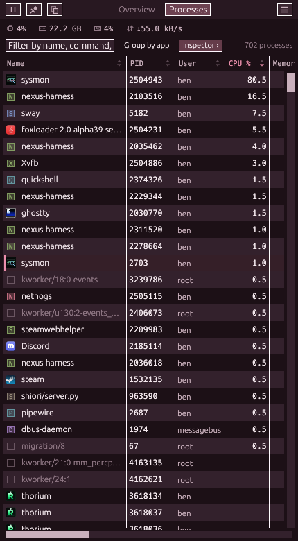

Shortcuts: `Ctrl+1` Overview, `Ctrl+2` Processes, `Ctrl+F` the
filter, `P` pin.

## The API

```bash
sysmon probe [section]      # one-shot JSON (works with nothing running)
sysmon tap network -i 2     # NDJSON stream — the desktop-bar diet
sysmon ctl shot /tmp/s.png  # drive the window: pages, themes, pop-outs, screenshots
sysmon serve                # headless daemon; idle = literally zero sampling
sysmon specs                # what the machine is: the shareable spec sheet
sysmon history gpu --since 2h   # what it did: usage over a range, from disk
sysmon schema               # the machine-readable map of everything
```

One envelope per reply, errors always carry a `fix`, exit codes
0/2/3/4, JSON automatic when piped. The full contract with examples:
[docs/API.md](docs/API.md), `man sysmon`, `sysmon schema`.

Degraded modes are disclosed, never silent: if the window has to
render without GPU acceleration (no usable Vulkan driver), it says
so at startup and `ctl status` carries `renderer_hint` with the fix
— a monitor is never allowed to be mysteriously slow.

### Per-process network without root

The engine asks netlink `sock_diag` for every TCP socket's kernel
byte counters (the numbers `ss -ti` shows) and resolves socket
inodes to pids — real per-process rates, no packet capture, no
setup. If [nethogs](https://github.com/raboof/nethogs) is installed
with capture caps, it takes over as the source: packet truth,
UDP/QUIC, other users' processes:

```bash
sudo apt install nethogs
sudo setcap 'cap_net_admin,cap_net_raw+ep' $(which nethogs)
```

The UI and the API always disclose which source fed them.

## Accuracy

Two layers, both on real hardware:

- `scripts/accuracy-audit.sh` puts every number the app shows next to
  the tool a human would check it with (`free`, `turbostat`, `mpstat`,
  `sensors -j`, `lspci`, `df`, `findmnt`, `ps`, firmware DIMM tables),
  once idle and once under `stress-ng` load, and writes a report.
- `cargo test` cross-checks each reading against an independent read
  of the same source, with the tolerance and its reason stated.

The ways each number could mislead are written down first
([FAILURE-MODES.md](docs/dev/FAILURE-MODES.md)); each fix starts as a
failing test. A failing check is a collector bug, and tolerances never
widen to pass. Every definition and its authority:
[docs/dev/ACCURACY.md](docs/dev/ACCURACY.md).

## Install

Packages and checksums on the
[releases page](https://github.com/RamenFast/sysmon/releases).

```bash
# Debian / Ubuntu / Mint
sudo apt install ./sysmon_3.7.0_amd64.deb

# Fedora / RHEL (built on Mint, rpm --test verified — reports welcome)
sudo dnf install ./sysmon-3.7.0-1.x86_64.rpm

# from source
sudo apt install build-essential curl git            # apt
sudo dnf install gcc make curl git                   # dnf
curl --proto '=https' --tlsv1.2 -sSf https://sh.rustup.rs | sh
git clone https://github.com/RamenFast/sysmon && cd sysmon
cargo build --release && sudo install -m755 target/release/sysmon /usr/local/bin/
```

Verify: `sysmon --version` → `sysmon 3.7.0 (v3)`.

Runs everywhere a Linux desktop runs; the GPU card wants an amdgpu
card, the NVIDIA card the proprietary driver's libnvidia-ml, and
everything else degrades gracefully. Motherboard fan and voltage
sensors need your board's Super-I/O driver loaded (on most AMD boards,
`sudo modprobe nct6775`); drive temperatures need `drivetemp`.

## Gallery

Eleven palettes, all first-class — switching themes changes the room,
not just the paint. Blossom Dark is the default; System mode follows
your GTK theme's family, and hands you Greyscale when your desktop
asks for high contrast.

| | |
|---|---|
| 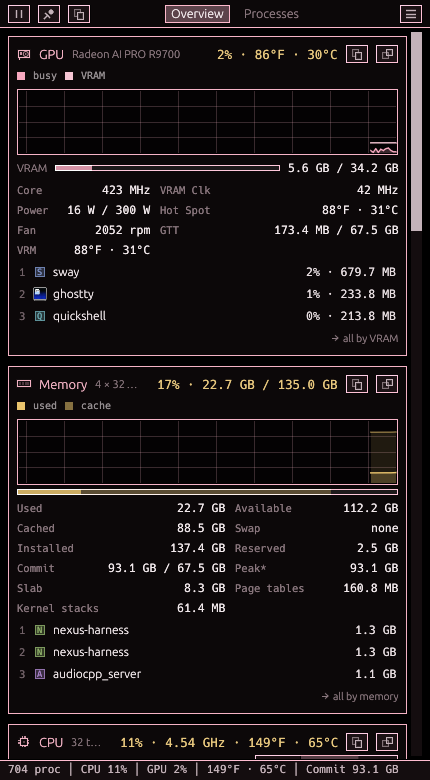 *Blossom AMOLED — v1's true-black look* | 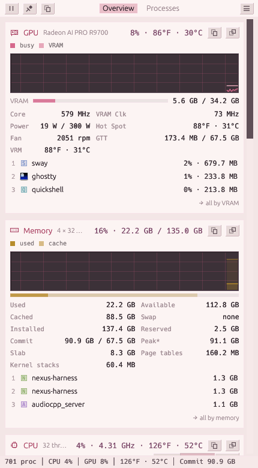 *Blossom — petal on paper* |
| 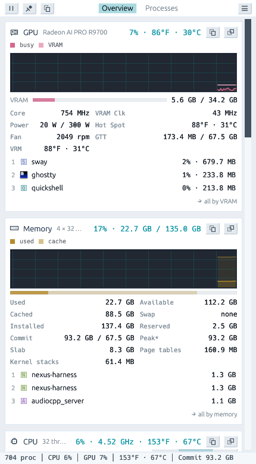 *Light* | 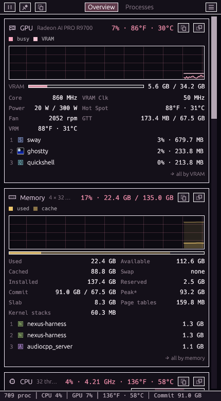 *Dark* |
| 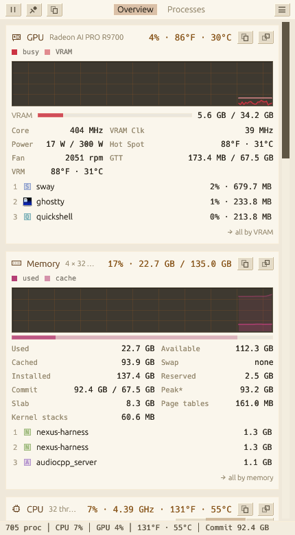 *Paper — warm reading light* | 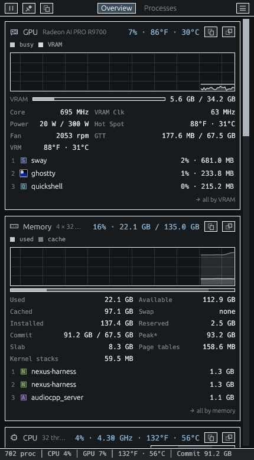 *Basalt — bevel city* |
| 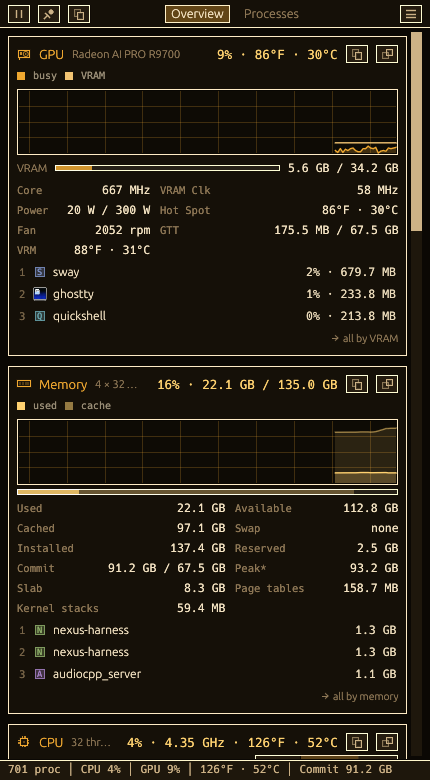 *Amber CRT* | 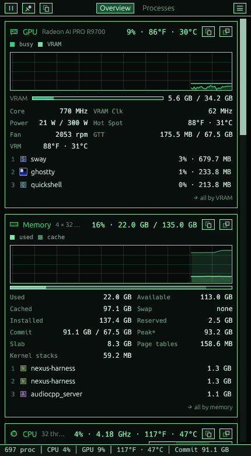 *Chromacore — the 1905 terminal* |
| 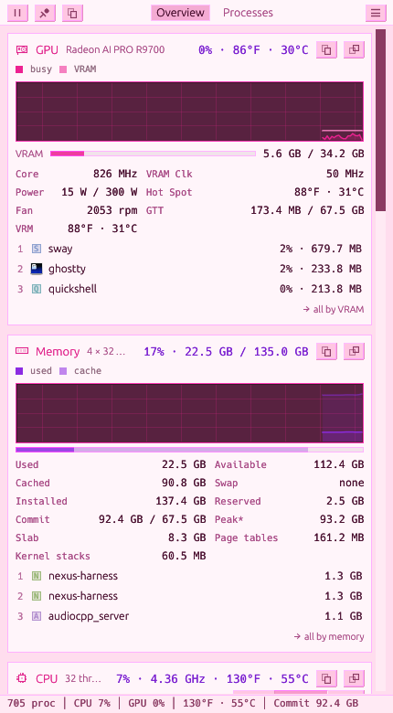 *Funky Pink* | 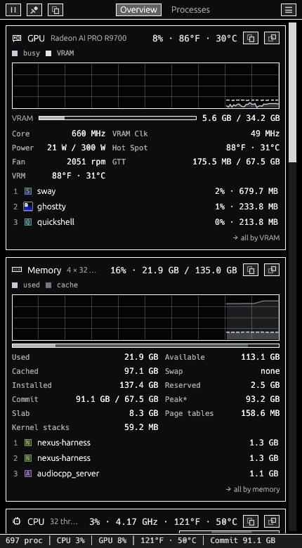 *Greyscale — the a11y floor, WCAG AAA* |
| 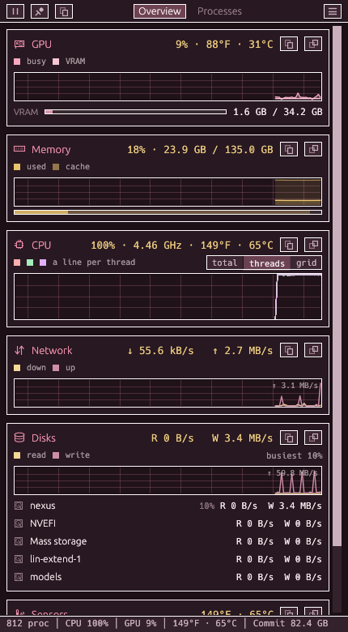 *Compact mode* | |

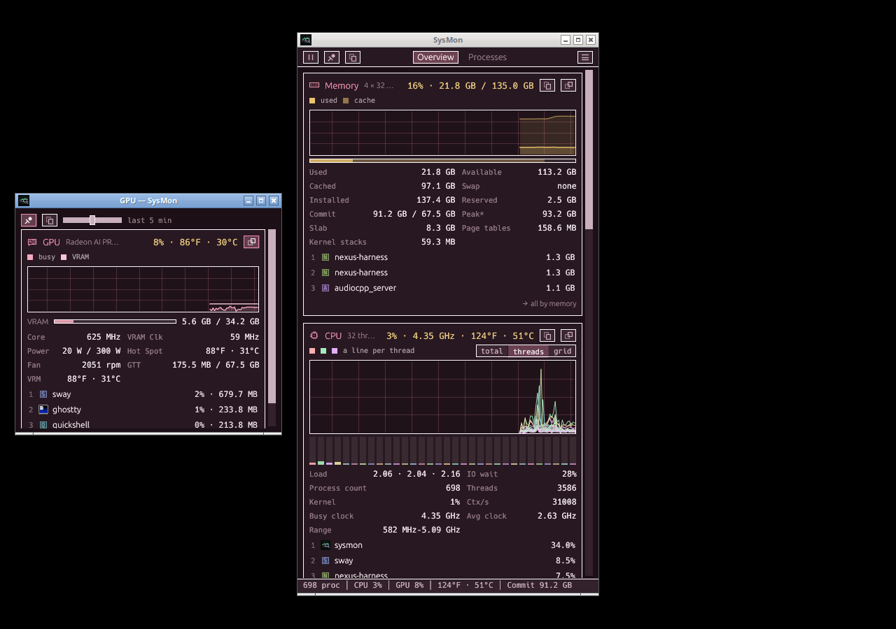
*A popped-out GPU card living its own life.*

## Layout & docs

```
crates/sysmon-core   the engine: collectors, snapshot model (the wire
                     contract), desktop-entry/icon index, accuracy suite
crates/sysmon-app    the binary: GUI (eframe/egui), CLI verbs, control
                     socket, kittest UI tests
scripts/e2e.sh       the live receipt run (Xvfb: screenshots, drag-dock,
                     single-instance, contract checks; then native Wayland)
scripts/accuracy-audit.sh  every shown number vs free/turbostat/sensors/…
packaging/           deb + rpm builds, manpage, desktop entry
```

Working on it (human or agent)? The docs assume zero context:

- [CLAUDE.md](CLAUDE.md) — laws, commands, gotchas (auto-loaded by Claude Code)
- [docs/AGENTS.md](docs/AGENTS.md) — driving the app/API as an agent
- [docs/ARCHITECTURE.md](docs/ARCHITECTURE.md) — the developer map: crates, data flow, threading
- [docs/dev/EXTENDING.md](docs/dev/EXTENDING.md) — checklists: add a collector/card/verb/palette/column
- [docs/dev/TESTING.md](docs/dev/TESTING.md) — the five test layers + the Xvfb gotchas
- [docs/dev/ACCURACY.md](docs/dev/ACCURACY.md) — every number's authority and tolerance
- [docs/dev/FAILURE-MODES.md](docs/dev/FAILURE-MODES.md) — how each number could lie, and what catches it
- [HANDOFF.md](HANDOFF.md) — project state and the next-session ledger

## License & credits

GPL-3.0-or-later — see [LICENSE](LICENSE).

Built by Ben with [Claude Code](https://claude.com/claude-code)
(Claude Fable 5) — engine, chrome, tests, and the accuracy suite in
one very long, very pink session. The 3.1 accuracy round (the live
audit, the Inspector, the sensors rework, the glyphs) was built in
[Jcode](https://github.com/1jehuang/jcode) with Claude Opus 5.5, with
two read-only Opus 5.5 workers auditing and reviewing.
